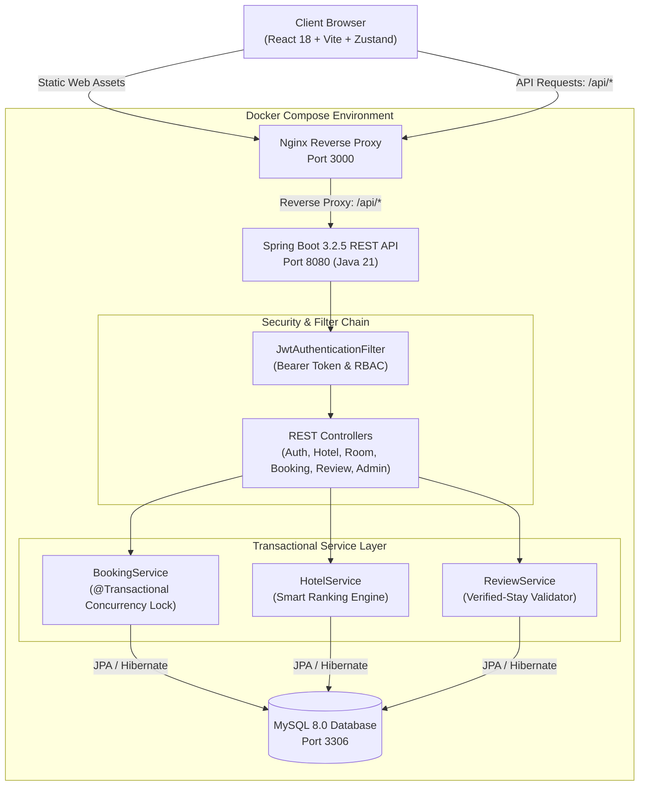
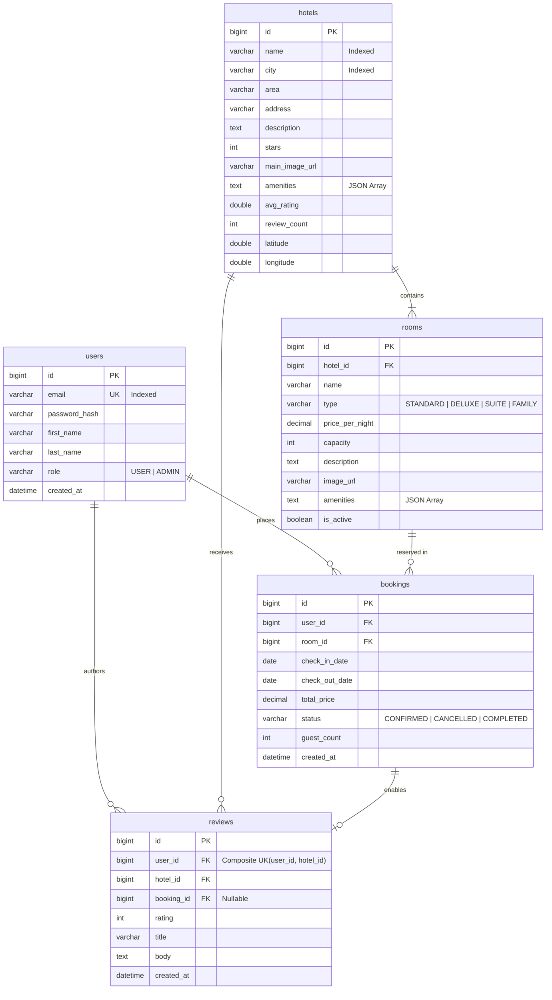

<div align="center">

# Staywise

### *Quiet Luxury Meets Modern Travel*

A production-grade, full-stack hotel discovery and reservation platform engineered with **Java 21**, **Spring Boot 3.2**, **React 18**, and **MySQL 8**.

Featuring explainable hotel search ranking, concurrency-safe room reservations, verified-stay guest reviews, and role-based administration.

<br />

[](https://openjdk.org/projects/jdk/21/)
[](https://spring.io/projects/spring-boot)
[](https://react.dev/)
[](https://www.typescriptlang.org/)
[](https://vitejs.dev/)
[](https://tailwindcss.com/)
[](https://www.mysql.com/)
[](https://www.docker.com/)

<br />

<!-- Project Banner Placeholder -->
```
+----------------------------------------------------------------------------------------------------+
|                                                                                                    |
|                                            STAYWISE                                                |
|                            Discover Curated Luxury Stays Across India                              |
|                                                                                                    |
|        [ Mumbai ]      [ Delhi ]      [ Goa ]      [ Jaipur ]      [ Bangalore ]      [ Kolkata ]  |
|                                                                                                    |
+----------------------------------------------------------------------------------------------------+
```

</div>

---

## Table of Contents

- [Overview](#overview)
- [Key Features](#key-features)
- [System Architecture](#system-architecture)
- [Database Design](#database-design)
- [Smart Hotel Ranking Engine](#smart-hotel-ranking-engine)
- [Technology Stack](#technology-stack)
- [Getting Started](#getting-started)
  - [Prerequisites](#prerequisites)
  - [Environment Variables](#environment-variables)
  - [Docker Compose Deployment (Recommended)](#docker-compose-deployment-recommended)
  - [Local Bare-Metal Development](#local-bare-metal-development)
- [API Reference](#api-reference)
- [Testing & Quality Assurance](#testing--quality-assurance)
- [Development Roadmap](#development-roadmap)
- [Author & Acknowledgments](#author--acknowledgments)

---

## Overview

**Staywise** (formerly StayFinder) is designed for modern travelers seeking distinguished heritage palaces, tranquil coastal villas, and high-end urban retreats across India. 

Rather than functioning as a surface-level demo, the application implements real-world business constraints:
- **Zero Double-Bookings**: Guaranteed atomic reservations with interval intersection queries.
- **Explainable Ranking**: Search results tell travelers *why* a property is ranked ahead (relevance, ratings, review volume).
- **Verified-Only Reviews**: Only travelers with completed reservations can submit ratings, preventing counterfeit feedback.
- **Stateless Security**: Granular RBAC (`USER` and `ADMIN`) backed by short-lived JWT access tokens and long-lived refresh tokens.

---

## Key Features

### Implemented Features

| Feature | Description | Status |
| :--- | :--- | :---: |
| **Curated Discovery** | Editorial homepage with curated destination portals, trending filters, and distinguished properties. | Verified |
| **Smart Ranked Search** | Full-text query against property name, city, and area with multi-factor scoring and human-readable explanation tags. | Verified |
| **Real-Time Availability** | Dynamic date-range room availability checking ensuring only unreserved rooms appear for booking. | Verified |
| **Transactional Reservations** | Double-booking prevention using transactional database overlap checks and automatic price computation. | Verified |
| **Verified Stay Reviews** | Authenticated review submission gated by completed reservation history; recalculates property average ratings automatically. | Verified |
| **User Dashboard** | "My Trips" itinerary manager with upcoming stay cancellation and review submission modals. | Verified |
| **Role-Based Admin Panel** | Management suite for creating/updating hotels, configuring room inventories, auditing platform bookings, and viewing users. | Verified |
| **Token Refresh Lifecycle** | Silent JWT access token renewal via Axios interceptors upon HTTP 401 expiration. | Verified |
| **Containerized Orchestration** | Multi-stage Docker builds for backend (Maven 3.9 + Java 21) and frontend (Vite + Nginx) with automated database seeding. | Verified |

---

## System Architecture

Staywise follows a clean multi-tier architecture isolating client presentation, reverse-proxy routing, stateless API business logic, and relational persistence.



---

## Database Design

All database entities are mapped using Hibernate JPA to MySQL with cascading constraints and transactional integrity.



### Core Business Constraints

1. **Double-Booking Guard**: A room cannot be booked if an existing reservation overlaps the target window:
   $$\text{existing.checkIn} < \text{requested.checkOut} \quad\land\quad \text{existing.checkOut} > \text{requested.checkIn}$$
2. **Review Integrity**: A user can only review a hotel if they hold a completed booking (`status = 'COMPLETED'`) at that property, restricted to 1 review per hotel via composite key `(user_id, hotel_id)`.
3. **Rating Recalculation**: Every approved review automatically triggers a transactional recalculation of `avg_rating` and `review_count` on the parent hotel record.

---

## Smart Hotel Ranking Engine

Staywise implements an explainable scoring algorithm (`HotelService.java`) that evaluates keyword relevance alongside social proof:

```
Total Score = MatchScore + RatingBoost + PopularityBoost
```

| Factor | Condition | Score Weight | Explanation Tag Generated |
| :--- | :--- | :---: | :--- |
| **Exact Name Match** | Property name equals search query | `+100` | `"Exact name match"` |
| **Partial Name Match** | Property name contains search query | `+80` | `"Name match"` |
| **Exact City Match** | City equals search query | `+50` | `"City match"` |
| **Partial City Match** | City contains search query | `+35` | `"City match"` |
| **Area Match** | Area/district contains search query | `+30` | `"Area match"` |
| **Star Rating Boost** | Based on customer reviews | `+(avgRating × 10)` | `"4.9★ rated"` |
| **Review Saturation** | Logarithmic popularity scaling | `+min(reviewCount, 50)` | Factors into top placement |

*Fallback Explanation*: If no specific keywords are queried, the tag defaults to `"{City} · {Stars} stars"`.

---

## Technology Stack

### Backend
- **Language**: Java 21 (LTS)
- **Framework**: Spring Boot 3.2.5
- **Security**: Spring Security 6.2 with stateless JWT (`jjwt-api:0.12.3`)
- **Data & Persistence**: Spring Data JPA & Hibernate with MySQL Connector/J
- **Validation**: Jakarta Bean Validation (`spring-boot-starter-validation`)
- **Testing**: JUnit 5, Mockito, Spring Test

### Frontend
- **Framework**: React 18.2 with TypeScript 5.2
- **Build Tool**: Vite 5.0 (ESM production bundler)
- **Styling**: Tailwind CSS 3.4 with custom Quiet Luxury design tokens
- **Server State**: TanStack React Query v5 (5-minute cache stale time)
- **Client State**: Zustand 4.4 with `localStorage` authentication persistence
- **Routing**: React Router DOM 6.21 with lazy-loaded route splitting
- **Icons & Utilities**: Lucide React, date-fns

### Infrastructure
- **Database**: MySQL 8.0 Community Server
- **Web Server**: Nginx Alpine (Reverse proxy and SPA routing)
- **Containerization**: Docker Compose (multi-stage Maven and Node builds)

---

## Getting Started

### Prerequisites
- [Docker Desktop](https://www.docker.com/products/docker-desktop/) (Version 24+)
- **For local bare-metal run**:
  - JDK 21 (Eclipse Temurin recommended)
  - Node.js 20+ and npm 10+
  - Apache Maven 3.9+
  - MySQL 8.0 instance running on port 3306

---

### Environment Variables

Copy the provided `.env.example` to `.env`:

```bash
cp .env.example .env
```

| Variable | Description | Default Example |
| :--- | :--- | :--- |
| `DB_HOST` | Database host | `mysql` (Docker) or `localhost` (Local) |
| `DB_PORT` | Database port | `3306` |
| `DB_NAME` | Database schema name | `stayfinder` |
| `DB_USER` | MySQL user | `root` or `stayfinder` |
| `DB_PASSWORD` | MySQL user password | `rootpassword` |
| `MYSQL_ROOT_PASSWORD` | Admin password for container | `rootpassword` |
| `JWT_SECRET` | 256-bit+ HMAC cryptographic key | `dGhpc2lzYXZlcnlzZWNyZXRrZXlmb3Jqd3R0b2tlbnByb3ZpZGVyc3RheWZpbmRlcg==` |
| `SPRING_PROFILES_ACTIVE` | Active Spring profile | `docker` or `dev` |

---

### Docker Compose Deployment (Recommended)

1. **Clone repository and launch containers**:
   ```bash
   git clone https://github.com/lohit-bhaware/Staywise.git
   cd Staywise
   docker compose up --build -d
   ```

2. **Verify running containers**:
   ```bash
   docker ps
   ```

3. **Access points**:
   - **Web Application**: [http://localhost:3000](http://localhost:3000)
   - **Backend API**: [http://localhost:8080/api](http://localhost:8080/api)
   - **MySQL Database**: `localhost:3306`

*Note: On first startup, `DataSeeder.java` automatically populates hotels across Mumbai, Delhi, Bangalore, Goa, and Jaipur.*

---

### Local Bare-Metal Development

If you prefer running services directly on your host machine:

#### 1. Start MySQL
Ensure MySQL is running on `localhost:3306` and create the schema:
```sql
CREATE DATABASE IF NOT EXISTS stayfinder;
```

#### 2. Start Spring Boot Backend
```bash
cd backend
mvn clean spring-boot:run
```
*API boots on `http://localhost:8080`.*

#### 3. Start Vite Frontend
```bash
cd frontend
npm install
npm run dev
```
*Vite dev server boots on `http://localhost:5173` with automated API proxying to `localhost:8080`.*

---

## API Reference

### Authentication (`/api/auth`)
| Method | Endpoint | Access | Description |
| :--- | :--- | :---: | :--- |
| `POST` | `/api/auth/register` | Public | Create new guest user account |
| `POST` | `/api/auth/login` | Public | Authenticate user and receive JWT access & refresh tokens |
| `POST` | `/api/auth/refresh` | Public | Issue fresh access token using valid refresh token |

### Hotels & Search (`/api/hotels`)
| Method | Endpoint | Access | Description |
| :--- | :--- | :---: | :--- |
| `GET` | `/api/hotels` | Public | Search and retrieve scored hotels (`query`, `city`, `page`, `size`) |
| `GET` | `/api/hotels/{id}` | Public | Retrieve hotel details, images, amenities, and room list |
| `GET` | `/api/hotels/{id}/rooms` | Public | Query available rooms for a given `checkIn` and `checkOut` range |
| `GET` | `/api/hotels/{id}/reviews` | Public | Paginated reviews for a specific property |

### Rooms (`/api/rooms`)
| Method | Endpoint | Access | Description |
| :--- | :--- | :---: | :--- |
| `GET` | `/api/rooms/{id}` | Public | Retrieve single room specifications and pricing |
| `PUT` | `/api/rooms/{id}` | `ADMIN` | Update room pricing, capacity, or active status |

### Bookings (`/api/bookings`)
| Method | Endpoint | Access | Description |
| :--- | :--- | :---: | :--- |
| `POST` | `/api/bookings` | `USER` | Create new reservation with double-booking check |
| `GET` | `/api/bookings/my` | `USER` | Retrieve authenticated user's itinerary history |
| `GET` | `/api/bookings/{id}` | `USER` | Get single booking receipt details |
| `PUT` | `/api/bookings/{id}/cancel` | `USER` | Cancel an upcoming confirmed reservation |

### Reviews (`/api/reviews`)
| Method | Endpoint | Access | Description |
| :--- | :--- | :---: | :--- |
| `POST` | `/api/reviews` | `USER` | Submit verified review (requires prior completed booking) |
| `GET` | `/api/reviews/my` | `USER` | Retrieve all reviews authored by authenticated user |
| `DELETE`| `/api/reviews/{id}` | `USER` | Remove author's own review |

### Administration (`/api/admin`)
| Method | Endpoint | Access | Description |
| :--- | :--- | :---: | :--- |
| `GET` | `/api/admin/hotels` | `ADMIN` | List all system hotels |
| `POST` | `/api/admin/hotels` | `ADMIN` | Register a new hotel property |
| `PUT` | `/api/admin/hotels/{id}` | `ADMIN` | Edit hotel details and amenity list |
| `POST` | `/api/admin/hotels/{id}/rooms` | `ADMIN` | Add room inventory to a hotel |
| `GET` | `/api/admin/bookings` | `ADMIN` | System-wide paginated audit of all bookings |
| `GET` | `/api/admin/users` | `ADMIN` | View registered platform users and assigned roles |

---

## Testing & Quality Assurance

Staywise maintains strict verification standards across backend and frontend layers:

- **Backend Unit & Service Tests**:
  - `BookingServiceTest.java`: Validates concurrency locks, interval collision rejections, ownership constraints, and cancellation workflows.
  - `HotelServiceTest.java`: Validates scoring formula weights, ranking explanations, and `minPrice` room derivations.
  - `ReviewServiceTest.java`: Validates verified-stay gating, duplicate review rejection, and rating updates.
  - `JwtTokenProviderTest.java`: Validates token claims extraction, expiration thresholds, and cryptographic signature validation.
  - Test command:
    ```bash
    cd backend
    mvn test-compile
    ```

- **Frontend Build & Static Typing**:
  - Full TypeScript strict-mode compatibility (`tsc && vite build`).
  - ESLint verification with clean 0-error, 0-warning output (`npm run lint`).
  - Test command:
    ```bash
    cd frontend
    npm run build
    npm run lint
    ```

- **End-to-End Container Workflow**:
  - Automated 10-step integration script verifying container health, token issuance, double-booking rejection (HTTP 409 Conflict), review verification gating (HTTP 400), and administrative access.

---

## Development Roadmap

The core discovery, ranking, reservation, and administration flows are fully implemented. Future roadmap enhancements include:

- [ ] **Payment Gateway Integration**: Integration with Razorpay / Stripe for live transaction processing.
- [ ] **Email Dispatch Service**: Automated booking receipts and check-in reminders using Spring Mail and Thymeleaf templates.
- [ ] **Multi-Room Group Bookings**: Ability to reserve multiple rooms in a single transaction.
- [ ] **Cloud Asset Storage**: Direct image upload to AWS S3 / Cloudinary for admin property management.

---

## Author & Acknowledgments

**Crafted with care by Lohit Bhaware**

- **LinkedIn**: [lohit-bhaware](https://www.linkedin.com/in/lohit-bhaware)
- **GitHub**: [@lohit-bhaware](https://github.com/lohit-bhaware)
- **X**: [@LohitXD](https://x.com/LohitXD)
- **Contact**: [lohitbhaware01@outlook.com](mailto:lohitbhaware01@outlook.com)

---

<div align="center">
  <sub>Built for the modern traveler. Powered by Spring Boot & React.</sub>
</div>
